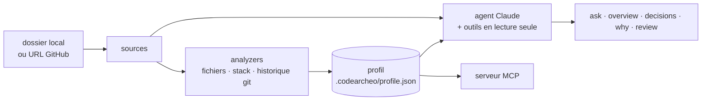

> Commencé : novembre 2026

<div align="center">

# codearcheo

L'archéologie de ton code : retrouver pourquoi un projet est construit comme il l'est.


*Anciennement `learn-it`, renommé le 20 novembre 2026.*

</div>

---

## Table des matières

1. [À propos du projet](#à-propos-du-projet)
   - [Construit avec](#construit-avec)
2. [Pour commencer](#pour-commencer)
   - [Prérequis](#prérequis)
   - [Installation](#installation)
3. [Utilisation](#utilisation)
   - [Configuration](#configuration)
4. [Comment ça marche](#comment-ça-marche)
5. [Organisation du code](#organisation-du-code)
6. [Feuille de route](#feuille-de-route)
   - [Où en est le projet](#où-en-est-le-projet)
7. [Contribuer](#contribuer)
8. [Licence](#licence)
9. [Contact](#contact)
10. [Remerciements](#remerciements)

---

## À propos du projet

Le code dit **quoi**. Presque jamais **pourquoi**. Pourquoi PostgreSQL plutôt que MongoDB ?
Pourquoi ce service à part ? La réponse est éparpillée dans l'historique git, les messages de
commit, des docs à moitié à jour et la tête de gens partis depuis.

codearcheo est une CLI Python qui fouille un projet local ou un dépôt GitHub comme un
archéologue fouille un site : elle établit d'abord les faits sans IA (stack, dates d'adoption,
historique), puis un agent Claude enquête dans le code et l'historique pour répondre à tes
questions. **Chaque affirmation cite sa source** (`src/db.py:12-40`, `commit a1b2c3d`), et
codearcheo vérifie que ces références existent.

```console
$ codearcheo scan https://github.com/maximilien-ilic/Crud-security-formula1
14 fichiers · langages : PHP (11), SQL (1), CSS (1)
16 commit(s) · 2 contributeur(s) · du 2026-02-16 au 2026-03-02
┏━━━━━━━━┳━━━━━━━━━━━┳━━━━━━━━━━━━━━━┳━━━━━━━━━━━━━━━━━━━━━━━━━━━━━━━━━━━━━━━━━┓
┃ Techno ┃ Catégorie ┃ Détectée dans ┃ Adoptée                                 ┃
┡━━━━━━━━╇━━━━━━━━━━━╇━━━━━━━━━━━━━━━╇━━━━━━━━━━━━━━━━━━━━━━━━━━━━━━━━━━━━━━━━━┩
│ PHP    │ language  │ index.php     │ 2026-02-16 · 8c6635d · add : fichier    │
│        │           │               │ php                                     │
│ MySQL  │ data      │ ajouter.php   │ 2026-02-19 · ee7100a · add: function    │
│        │           │               │ ajouter                                 │
└────────┴───────────┴───────────────┴─────────────────────────────────────────┘
```

**Ce que sait faire codearcheo :**
- Dresser la carte d'un projet sans IA : langages, stack et date d'adoption de chaque techno,
  zones chaudes, docs, ADR existants, graphe des imports et travail non commité
- Répondre à n'importe quelle question sur le code, avec des citations vérifiées
- Reconstituer les décisions techniques (quoi, quand, pourquoi, conséquences) et les exporter en ADR
- Expliquer pourquoi un fichier, une dépendance ou un choix existe, en remontant jusqu'au commit d'origine
- Évaluer chaque décision (garder, améliorer ou remplacer), avec effort, impact et plan d'action
- Suivre l'évolution des technos et des décisions entre deux révisions git
- Donner les mêmes outils à ton agent (Claude Code, Cursor…) via un serveur MCP

### Construit avec

- [Python 3.11+](https://www.python.org/)
- [Typer](https://typer.tiangolo.com/) pour la CLI et [Rich](https://rich.readthedocs.io/) pour l'affichage
- [Pydantic](https://docs.pydantic.dev/) pour le modèle de données
- [Claude](https://www.anthropic.com/claude), via le [SDK Anthropic](https://github.com/anthropics/anthropic-sdk-python)
  ou [Claude Code](https://code.claude.com) sur un abonnement Claude
- [tree-sitter](https://tree-sitter.github.io/) pour le graphe des imports (Python, JS/TS, Go, Rust)
- [MCP](https://modelcontextprotocol.io/) pour exposer les outils à d'autres agents
- [uv](https://docs.astral.sh/uv/), [pytest](https://pytest.org/) et [Ruff](https://docs.astral.sh/ruff/)

---

## Pour commencer

### Prérequis

- Python 3.11 ou plus, git et [uv](https://docs.astral.sh/uv/)
- Pour les commandes IA : [Claude Code](https://code.claude.com) connecté à un abonnement Claude,
  ou une clé API Anthropic

### Installation

1. Installer la commande depuis PyPI

   ```sh
   uv tool install 'codearcheo[mcp,code]'
   ```

2. Pour les commandes IA, choisir l'abonnement Claude via Claude Code

   ```sh
   export CODEARCHEO_BACKEND=claude-code     # fish : set -Ux CODEARCHEO_BACKEND claude-code
   ```

   Ou utiliser une clé API avec le moteur `api` (par défaut) : `export ANTHROPIC_API_KEY=sk-ant-...`.

3. Vérifier l'installation sur un projet, sans IA et gratuitement

   ```sh
   codearcheo scan https://github.com/maximilien-ilic/Crud-security-formula1
   ```

Pour passer à une nouvelle version : `uv tool upgrade codearcheo`.

---

## Utilisation

La cible est le dossier courant par défaut, un dossier local, ou une URL GitHub
(en argument pour `scan`, avec `-p` pour les autres commandes).

| Commande | Question à laquelle elle répond | IA |
|---|---|:---:|
| `scan [CIBLE]` | De quoi est fait ce projet ? | non |
| `overview` | Comment est-il organisé ? Architecture avec diagramme, flux, ordre de lecture | oui |
| `ask "…"` | N'importe quelle question, avec une réponse sourcée | oui |
| `decisions` | Quelles décisions techniques ont été prises, quand et pourquoi ? | oui |
| `why <cible>` | Pourquoi ce fichier, cette dépendance ou ce choix existe-t-il ? | oui |
| `review [--path DOSSIER]` | Ces décisions sont-elles toujours les bonnes ? Par où commencer ? | oui |
| `chat` | Enchaîner les questions (moteur API uniquement) | oui |
| `diff [REF]` | Qu'est-ce qui a changé depuis une révision git ? | non |
| `serve` | Les mêmes outils pour ton agent, via MCP | — |

```sh
cd ~/code/mon-projet
codearcheo ask "Par où passe une requête, de l'API jusqu'à la base ?"
codearcheo decisions --export docs/adr       # les décisions, en fichiers ADR
codearcheo review --path src/api             # une revue limitée à un dossier

# Depuis Claude Code
claude mcp add codearcheo -- codearcheo serve -p ~/code/mon-projet
```

Les rapports sont enregistrés dans `.codearcheo/` à la racine du projet analysé
(`profile.json`, `overview.md`, `decisions.md`, `review.md`). Ce dossier s'exclut lui-même de git.
Les dépôts GitHub sont clonés une fois dans `~/.cache/codearcheo/`. Chaque commande IA affiche
son coût et sa durée : comptez de 20 s à 1 min par question sur un petit projet, et quelques
minutes pour une revue d'un gros dépôt.

### Configuration

| Variable | Défaut | Rôle |
|---|---|---|
| `CODEARCHEO_BACKEND` | `api` | `api` (clé API) ou `claude-code` (abonnement Claude, via `claude -p`) |
| `CODEARCHEO_MODEL` | `claude-opus-5-5` | modèle Claude |
| `CODEARCHEO_EFFORT` | `medium` | effort de raisonnement, de `low` à `max` |
| `CODEARCHEO_LANG` | `French` | langue des rapports (`ask` répond dans la langue de la question) |
| `CODEARCHEO_MAX_ITERATIONS` | `40` | nombre maximal de tours de l'agent |
| `CODEARCHEO_CACHE_DIR` | `~/.cache/codearcheo` | où sont clonés les dépôts GitHub |
| `ANTHROPIC_API_KEY` | — | clé API, pour le moteur `api` |

Les anciennes variables `LEARN_IT_*` restent lues quand les nouvelles sont absentes.

---

## Comment ça marche



1. **Les faits d'abord.** `scan` construit le profil sans IA : la stack vient des manifestes
   (`pyproject.toml`, `package.json`, `go.mod`, Dockerfile, CI…) ou du code (connexion PDO d'un
   projet PHP), et la date d'adoption de chaque techno vient de `git log -S`.
2. **Puis l'enquête.** L'agent part de ce profil et explore comme un développeur : il cherche,
   lit les passages utiles et remonte l'historique (`git log`, `git show`, `git blame`) jusqu'au
   commit qui a introduit un choix.
3. **Des réponses vérifiables.** Chaque citation est contrôlée, et ce qui est documenté reste
   séparé de ce qui est déduit. Un nom de fichier ambigu est signalé plutôt que deviné.

Les outils de l'agent sont en lecture seule et excluent les fichiers ignorés par git, les fichiers
sensibles (`.env`, `*.pem`, `id_rsa`…) et les liens symboliques. Pas d'index vectoriel : l'agent
voit toujours l'état actuel du code, travail non commité compris ([ADR 0002](docs/adr/0002-recherche-agentique.md)).

---

## Organisation du code

- `src/codearcheo/` : le paquet.
  - `cli.py` : les commandes (Typer). `config.py` : les réglages.
  - `analyzers/` : les faits sans IA (`inventory.py` fichiers et langages, `stack.py` stack
    technique, `history.py` historique et dates d'adoption, `code.py` graphe des imports).
  - `agent/` : la partie IA (`prompts.py` consignes, `tools.py` outils partagés avec MCP,
    `runner.py` moteur API, `claude_code.py` moteur abonnement).
  - `features.py` : ask, overview, decisions, why, review.
  - `evidence.py` : la vérification des citations. `store.py` : les fichiers de `.codearcheo/`.
  - `mcp_server.py` : `codearcheo serve`.
- `evals/` : l'évaluation des vraies réponses de Claude sur des projets de référence.
- `tests/` : les tests déterministes (aucun appel au modèle).
- `docs/` : les ADR du projet, les mesures et les guides (revues, publication, évaluation).

Les dépendances descendent : `analyzers` ignore tout de l'IA, `agent` ignore tout de la CLI.

Pour aller plus loin : [suivi des décisions](docs/decision-workflow.md),
[sources GitHub et ADR](docs/project-sources.md), [graphe des imports](docs/code-structure.md),
[chat et bilan d'usage](docs/agent-experience.md), [correction des citations](docs/citation-repair.md),
[évaluation](docs/evaluation.md) et [publication d'une version](docs/releasing.md).

---

## Feuille de route

- [x] Scan déterministe : stack, dates d'adoption à travers les migrations, historique, ADR existants
- [x] Graphe des imports avec tree-sitter, rapide même sur golang/go
- [x] Agent Claude avec citations vérifiées et correction facultative des citations
- [x] Décisions exportées en ADR, revue avec recommandations et tickets
- [x] Moteur sur l'abonnement Claude, sans clé API
- [x] Serveur MCP pour d'autres agents
- [x] Évaluation sur des projets réels en Python, JavaScript, Go et PHP
- [x] Revue automatique de chaque commit, par Codex et par Claude côté serveur
- [x] Version 0.2.0 publiée sur PyPI
- [x] Stack d'un projet sans manifeste : PHP, Python (`import`) et JavaScript (`require`, `import`)
- [x] Évaluation qui s'arrête proprement sur une coupure de quota et indique comment reprendre
- [ ] Étendre l'évaluation à d'autres langages (Rust, Java…) et à des dépôts plus variés

Le détail des jalons est dans [docs/roadmap.md](docs/roadmap.md).

### Où en est le projet

*État au 21 novembre 2026.*

- **La version 0.2.0** est publiée sur [PyPI](https://pypi.org/project/codearcheo/) et
  [GitHub](https://github.com/maximilien-ilic/codearcheo/releases/tag/v0.2.0).
- **Les tests.** 616 tests déterministes tournent sous Python 3.11 et 3.14 à chaque PR.
- **La qualité mesurée.** Depuis la mesure 10, neuf évaluations complètes sur l'abonnement
  donnent 123 réponses réussies sur 126. Les trois échecs datent d'avant les derniers
  changements : deux noms de fichier ambigus, que codearcheo refuse de deviner, et une raison
  déduite annoncée sans la formule demandée, que le prompt impose désormais (mesure 13 : 28/28).
  Le nouveau projet PHP réussit 4 cas sur 4 ([docs/evaluation.md](docs/evaluation.md)).
- **Le coût.** L'effort `medium`, par défaut, coûte 32 % de moins que `high` sans perte mesurée.
  Une évaluation complète (14 cas) prend environ 13 min.
- **Les revues.** Chaque commit sur `master` est relu par Codex et par Claude côté serveur
  ([docs/claude-review.md](docs/claude-review.md)), pour environ 0,10 $ par revue en équivalent API.
- **Aucun ticket bloquant n'est ouvert.**

---

## Contribuer

Les pull requests sont les bienvenues. Pour un gros changement, ouvre d'abord une issue.
[CONTRIBUTING.md](CONTRIBUTING.md) explique où ajouter du code, comment mesurer un changement
et comment le livrer.

```sh
git clone https://github.com/maximilien-ilic/codearcheo.git && cd codearcheo
uv sync --all-extras
uv run ruff check . && uv run pytest
```

---

## Licence

Distribué sous licence MIT. Voir [LICENSE](LICENSE).

---

## Contact

Maximilien Ilic — [LinkedIn](https://www.linkedin.com/in/maximilien-ilic/) —
[GitHub](https://github.com/maximilien-ilic)

---

## Remerciements

- [Claude](https://www.anthropic.com/claude) et [Claude Code](https://code.claude.com), le modèle et le moteur de l'agent
- [tree-sitter](https://tree-sitter.github.io/), pour l'analyse syntaxique
- Le [Model Context Protocol](https://modelcontextprotocol.io/), pour partager les outils avec d'autres agents
- Les projets de référence de l'évaluation : [Express](https://github.com/expressjs/express),
  [Go](https://github.com/golang/go) et [itsdangerous](https://github.com/pallets/itsdangerous)
- Le format [ADR](https://adr.github.io/) (Architecture Decision Records)
